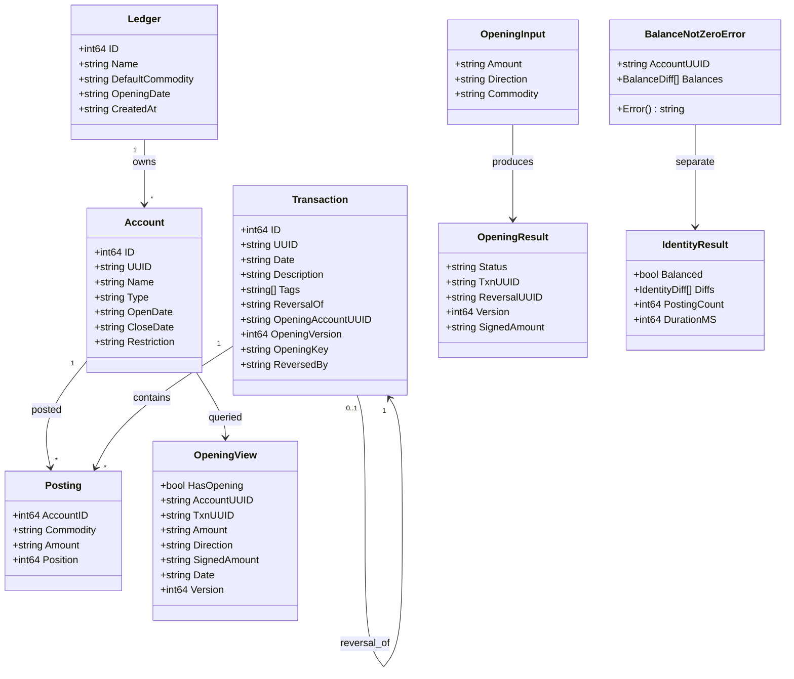
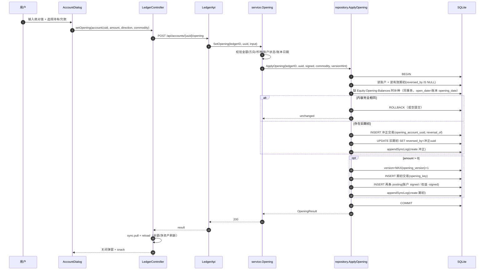
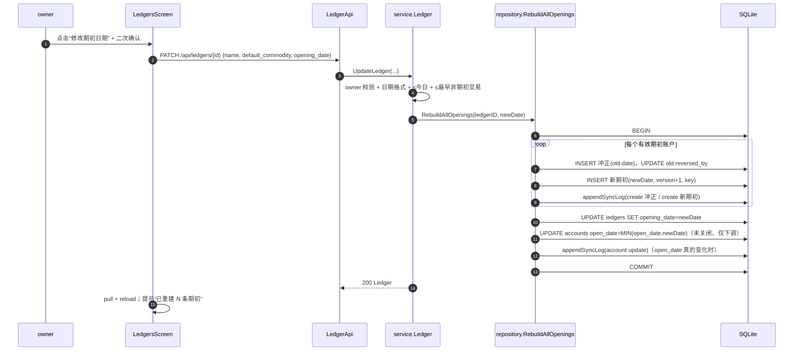
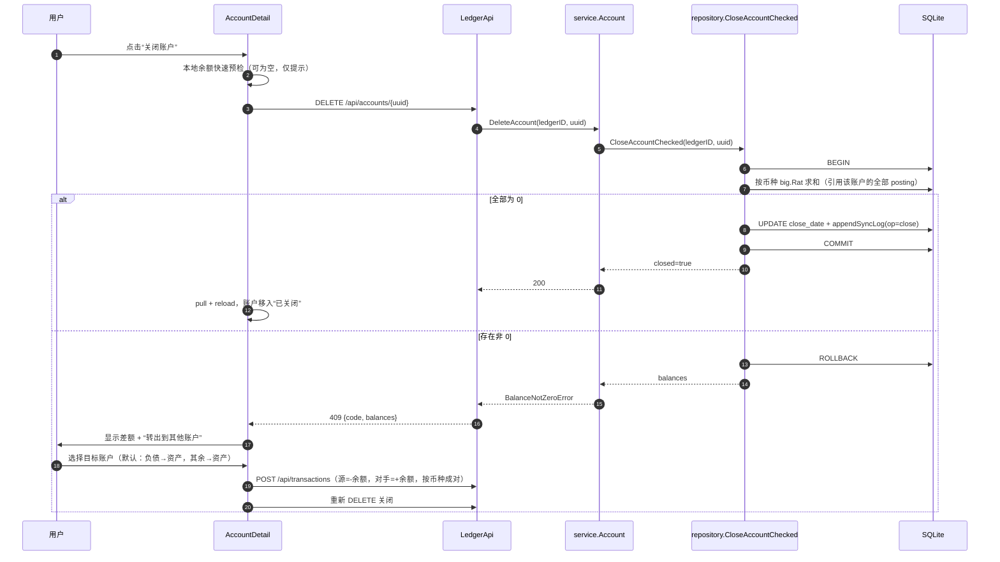
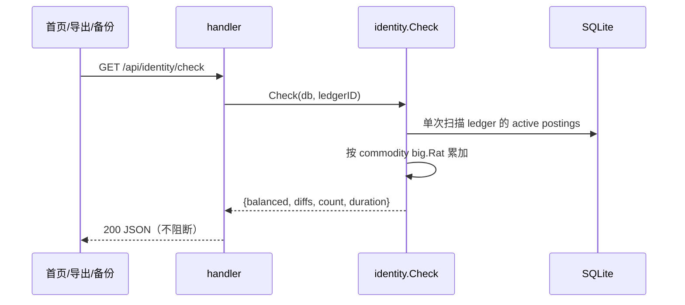
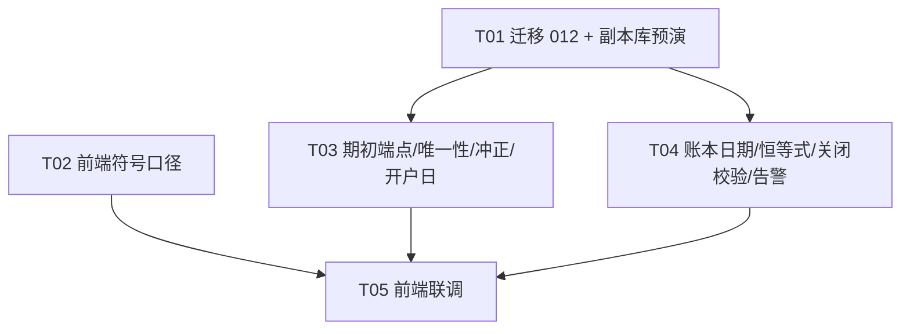

# 期初余额与账本净资产口径 — 系统设计（对应 PRD v1.1）

> 文档性质：架构设计（Part A）+ 可执行任务拆解（Part B）。
> 不包含业务代码，不执行迁移。所有实现须遵守 `AGENTS.md` 的硬约束（金额禁浮点、迁移优先、bean-check、同步协议、中文注释）。
> PRD：`docs/opening-balance-prd.md`（v1.1，未改动）。

---

## 决策记录（2026-11-05，老板拍板）

| 编号 | 决策 | 对设计的影响 |
|---|---|---|
| D-01 | 期初唯一性/冲正约束**提前到批一**，迁移 012 随批一上线；取消「批一用 tags、批二迁移回填」的过渡方案 | 删除 tags 承载期初身份的设计；012 一次完成列/索引/老数据启发式回填/账本日期回填/权益补种/开户日收敛；账本设置页与「重建全部期初交易」交互仍属批二 |
| D-02 | 关闭账户**仅在线**（离线端禁用并提示联网） | 保留 `CloseAccountChecked` + 409 差额明细；前端离线关闭按钮置灰，不入队 `op=close` |
| D-03 | 期初方向文案固定为**持有 / 欠款**（Assets 默认持有、Liabilities 默认欠款） | 全文统一为这两个词，不再保留「借/贷」「增加/减少」等候选文案 |

> 本设计 supersedes PRD v1.1 中「批一零迁移」的表述；PRD 由产品经理同步修订。

---

## 0. 结论摘要（先看这里）

1. **迁移编号固定为 `012_opening_balance`**：新增 `ledgers.opening_date`、`transactions` 的期初/冲正元数据列与 3 个索引；回填规则、期初权益账户补种、未关闭账户 `open_date` 下调全部在 012 内完成，幂等、可重跑。
2. **期初唯一性落库，不靠 tags 判断**：`transactions.opening_account_uuid + opening_key + reversed_by`，用
   - `UNIQUE(ledger_id, opening_key)`（幂等键 `opening:{account_uuid}:{version}`）
   - `UNIQUE(ledger_id, opening_account_uuid) WHERE reversed_by IS NULL AND deleted_at IS NULL`（每账户至多一条有效期初）
   在**数据库层**保证并发只成功一次；tags 仅作为展示/兼容标签，不参与唯一性判定。
3. **期初设置/修正是服务端单事务用例**：在线 `POST /api/accounts/{uuid}/opening`；不走通用 `POST /api/transactions`，也不走 `sync push`（两条入口本期起对 `opening` 标签一律拒绝，错误码 `opening_via_api_only`）。
4. **批一即落地迁移 012**：不再有 tags 过渡方案。012 建列（`opening_account_uuid / opening_version / opening_key / reversal_of / reversed_by`）、3 个部分唯一索引、`ledgers.opening_date` 及回填、权益补种、未关闭账户 `open_date` 收敛（FR-24）一次完成；老库期初交易（无 tags）按「description=期初余额 + Equity:Opening-Balances 对手分录 + 每账户最多一条」启发式回填，重复有效期初在 012 内生成真实冲正后去重。`tags` 仅保留 `opening` 作展示，不参与身份判定。
5. **符号口径三处真 bug**：`formatAmount` 无条件 `abs`、`computeNetWorth` 对负债乘 `-1`、`总负债` 展示依赖旧 `formatAmount` 的隐式 abs。其余 16 处 `.abs()` 均属「确实要绝对值」，保留并加注释。
6. **恒等式检查是只读独立包 `internal/identity`**：`GET /api/identity/check`，导出/备份/首页刷新三处只告警不阻断；1 万 posting 单次顺序扫描 + `big.Rat` 求和，目标 ≤300ms。
7. **关闭账户先校验余额为 0**：REST 与 sync `op=close` 同一校验（`CloseAccountChecked`），非 0 返回 `409 account_balance_not_zero` + 差额明细；**关闭仅在线**（已拍板）：前端离线状态关闭按钮置灰并提示「联网后操作」，避免「本地已关、服务端拒绝、待推送死循环」。
8. **任务共 5 个**：T01 迁移 012 + 副本库预演；T02 前端符号口径（与 T01 并行）；T03 期初专用端点 + 唯一性/冲正 + 开户日（依赖 T01）；T04 账本日期读写 + 恒等式 + 关闭校验 + 导出/备份告警（依赖 T01）；T05 前端联调（账本设置页 + 告警条 + 关闭转出 + 期初 API）。T03/T04 在 T01 完成后并行，T05 最后。

---

# Part A — 系统设计

## 1. 实现方案

### 1.1 技术栈与版本（显式）

| 层 | 选型 | 版本来源 |
|---|---|---|
| 后端语言 | Go | `go.mod` 指令 `go 1.25.0`；本机工具链 1.26.5 |
| HTTP | Go 标准库 `net/http`（`ServeMux` 路径参数） | 既有 |
| SQLite 驱动 | `modernc.org/sqlite` | `v1.56.0`（`go.mod`） |
| UUID | `github.com/google/uuid` | `v1.6.0`（`go.mod`） |
| 密码哈希 | `golang.org/x/crypto/bcrypt` | `v0.54.0`（`go.mod` 间接依赖，既有使用） |
| 前端 | Flutter Web（MVVM） | 本机 Flutter 3.38.9 / Dart 3.10.8；`pubspec.yaml` SDK `^3.9.0` |
| 精确金额（前端） | `decimal` | `^3.0.0` |
| 本地库 | `sembast` + `sembast_web` | `^3.7.0` / `^2.4.0` |
| 图表 | `fl_chart` | `^0.70.0` |
| HTTP（前端） | `http` | `^1.2.0` |
| bean-check | 项目 `.venv` 内 `beancount`，`python -m beancount.scripts.check` | 既有，不落系统 |

**本需求不新增任何第三方依赖**，避免触发锁文件漂移与全局安装。

### 1.2 架构模式

沿用现有分层，不引入新框架：

```text
Go：cmd/server → server（组合根：路由/CORS/auth/多账本上下文）
              → handler（薄 HTTP 适配）
              → service（用例编排、校验、事务边界）
              → repository（全部 SQL，单事务封装）
              → domain（实体/错误哨兵）
              + db（schema.sql + 追加式迁移）
              + identity（新增：只读恒等式检查，纯函数，可被 service/backup 复用）
              + export / backup（既有）
Flutter：api → store(sembast) → sync → viewmodels → screens/widgets
```

本需求新增一个**用例型服务** `service.Opening`：校验（日期、方向、符号、账户状态）在 service；**写事务**（冲正旧 → 建新 → sync_log）整体下沉到 `repository.ApplyOpening`，保证原子性与唯一索引语义。

### 1.3 关键设计决策

| 决策 | 选择 | 理由 |
|---|---|---|
| 期初身份 | `transactions` 元数据列（012 随批一上线） | 纯 tags 无法建唯一索引、无法在数据库层阻止重复；列可索引、可查询、可在 pull 中回传 |
| 迁移时机 | 批一即执行 012 | 唯一性/冲正约束与期初功能同批落地，避免两套身份来源与二次回填 |
| 并发唯一 | 部分唯一索引 + 单写事务 | SQLite 单进程写串行（`SetMaxOpenConns(1)`）叠加唯一索引，双击/并发重放只成功一次 |
| 幂等键 | `opening:{account_uuid}:{version}` | 与 PRD 一致；版本在账户维度单调递增，历史版本保留用于审计 |
| 期初入口 | 专用 REST 端点（在线） | 通用 push 是逐条、非事务、无「冲正旧+建新」原子语义 |
| 修正语义 | 冲正旧 + 新建 | 遵守 append-only、不可变交易；导出仍可被 bean-check 校验 |
| 账本日期修改 | 后端单事务重建全部期初 | 避免半旧半新；写 sync_log，客户端 pull 后一致（交互属批二） |
| 余额校验 | `big.Rat` 精确求和，不用 SQL NUMERIC 聚合 | SQLite NUMERIC 实际是浮点，金额禁浮点 |
| 关闭入口 | 仅在线 REST | 离线关闭无法原子校验余额，会造成待推送死循环（D-02） |
| 恒等式检查 | 独立 `internal/identity` 包 | service 与 backup 均可调用且不产生循环依赖；只读、无副作用 |
| Redis | 不引入 | 单机 SQLite、无队列/分布式锁需求；唯一性已由数据库索引承担 |

---

## 2. 全量文件清单

> 状态：M=修改，N=新增，R=只读参考（不改）。路径均相对项目根。

### 2.1 后端

| 文件 | 状态 | 内容 | 任务 |
|---|---|---|---|
| `internal/db/migrate.go` | M | 注册 `012_opening_balance` | T01 |
| `internal/db/migrate012.go` | N | 012 具体实现（列、`migration_log`、老数据启发式回填、补种、去重、索引、sync_log） | T01 |
| `internal/db/migrate012_test.go` | N | 012 在旧库副本/空库/二次执行上的断言 | T01 |
| `internal/domain/models.go` | M | `Ledger.OpeningDate`；`Transaction.ReversalOf/OpeningAccountUUID/OpeningVersion/OpeningKey/ReversedBy` | T03/T04 |
| `internal/domain/errors.go` | M | `ErrConflict` 复用；新增 `BalanceNotZeroError`、期初错误哨兵与错误码常量 | T03/T04 |
| `internal/repository/opening.go` | N | `ActiveOpening`、`ApplyOpening`（含 FR-08 权益补种，T03）；`RebuildAllOpenings`（T04） | T03/T04 |
| `internal/repository/opening_test.go` | N | 唯一索引、冲正、失败回滚；日期重建 | T03/T04 |
| `internal/repository/transaction.go` | M | 期初列读写、`reversed_of` 读取；`CloseAccountChecked`（事务内求余额后关闭） | T03/T04 |
| `internal/repository/account.go` | M | 按 uuid 取账户（含状态）、权益账户查询 | T03/T04 |
| `internal/repository/balance.go` | M | `AccountBalanceRats`（精确 big.Rat，用于关闭校验） | T04 |
| `internal/repository/ledger.go` | M | `ListLedgers`/`LedgerByID` 返回 opening_date；`LedgerOpeningDate`；`UpdateLedger` 持久化日期 | T03/T04 |
| `internal/service/opening.go` | N | `SetOpening`、`GetOpening`（T03）；`RebuildOpenings`（T04） | T03/T04 |
| `internal/service/opening_test.go` | N | 方向映射、币种优先级、权益兜底、幂等/冲正、并发；重建 | T03/T04 |
| `internal/service/identity.go` | N | `CheckIdentity` 薄封装 | T04 |
| `internal/service/identity_test.go` | N | 平衡/不平衡、精度、1 万 posting 计时 | T04 |
| `internal/identity/check.go` | N | 纯只读检查：按币种 big.Rat 汇总 | T04 |
| `internal/identity/check_test.go` | N | 同上，包内测试 | T04 |
| `internal/service/account.go` | M | `CreateAccount` 开户日取 `MIN(账本 opening_date, 今日)`（FR-03）；`DeleteAccount` 先校验再关闭 | T03/T04 |
| `internal/service/ledger.go` | M | `ListLedgers` 读取 opening_date；`CreateLedger` 写建账日；`UpdateLedger` 校验与重建编排（批二） | T04 |
| `internal/service/sync.go` | M | 交易实体透传 `reversed_of`；拒绝 `opening` 标签；close 走校验 | T03/T04 |
| `internal/service/transaction.go` | M | 通用创建/推送拒绝 `opening` 标签（防绕过） | T03 |
| `internal/handler/opening.go` | N | GET/POST `/api/accounts/{uuid}/opening` | T03 |
| `internal/handler/identity.go` | N | GET `/api/identity/check` | T04 |
| `internal/handler/account.go` | M | DELETE 透传 409 明细 | T04 |
| `internal/handler/ledger.go` | M | PATCH 增加可选 `opening_date` | T04 |
| `internal/handler/export.go` | M | 导出前检查并写 `X-Ledger-Balanced` / `X-Ledger-Diffs` | T04 |
| `internal/handler/handler.go` | M | `BalanceNotZeroError` → 409 + 结构化 body | T04 |
| `internal/server/router.go` | M | 注册 opening / identity 路由 | T03/T04 |
| `internal/server/middleware.go` | M | `Access-Control-Expose-Headers` 暴露告警头；CORS Methods 不变 | T04 |
| `internal/backup/engine.go` | M | 快照后全库恒等式检查，写 `identity_warnings`（只告警） | T04 |
| `internal/seed/accounts.go` | M | 默认账户含 `Equity:Opening-Balances` | T03 |
| `schema.sql` | R | 不改；新列只走 012（遵循「迁移优先」） | — |
| `internal/export/beancount.go` | R | 不改；`open` 指令日期由 `accounts.open_date` 决定 | — |

### 2.2 前端

| 文件 | 状态 | 内容 | 任务 |
|---|---|---|---|
| `frontend/lib/utils/money.dart` | M | `formatAmount` 去 abs；`formatMoney` 符号前置、避免双重负号 | T02 |
| `frontend/lib/utils/opening.dart` | N | 纯函数：绝对值 + 持有/欠款 → 有符号金额；按账户类型给默认方向（仅 UI 预览，不生成交易） | T05 |
| `frontend/lib/core/store/local_store.dart` | M | 净值算式修正、双算校验；账本 opening_date 缓存；不再改写期初 tags | T02/T05 |
| `frontend/lib/core/models/transaction.dart` | M | 保持 `reversedOf`；pull 映射新字段 | T05 |
| `frontend/lib/core/api/opening_models.dart` | N | `OpeningView`、`OpeningResult`、`IdentityResult`、`BalanceDiff` | T05 |
| `frontend/lib/core/api/ledger_api.dart` | M | opening GET/POST、identity、updateLedger 日期、ApiException 带 code/details、导出头读取 | T05 |
| `frontend/lib/core/api/sync_models.dart` | M | `Ledger.openingDate` | T05 |
| `frontend/lib/core/sync/sync_service.dart` | M | 在线期初/关闭改为 REST；离线禁用；pull 处理 `reversed_of` | T05 |
| `frontend/lib/viewmodels/ledger_controller.dart` | M | 净值双算日志、opening 读写、关闭已校验、identity 状态、账本日期缓存 | T02/T05 |
| `frontend/lib/viewmodels/auth_controller.dart` | M | 账本列表缓存 opening_date | T05 |
| `frontend/lib/screens/accounts/account_dialog.dart` | M | 绝对值 + 持有/欠款方向（仅 Assets/Liabilities）；编辑态只改期初；开户日默认账本期初日期且不可更晚；期初标签仅 `opening` | T05 |
| `frontend/lib/screens/accounts/account_detail_screen.dart` | M | 关闭仅在线：离线按钮置灰并提示联网；409 差额展示、转出引导 | T05 |
| `frontend/lib/screens/accounts/accounts_screen.dart` | M | 净资产文案；总负债显式 abs | T02 |
| `frontend/lib/screens/dashboard/dashboard_screen.dart` | M | 净资产文案；恒等式告警横幅 | T02/T05 |
| `frontend/lib/screens/reports/reports_screen.dart` | M | 净资产文案；总负债显式 abs | T02 |
| `frontend/lib/screens/settings/ledgers_screen.dart` | M | owner 修改期初日期（二次确认，批二） | T05 |
| `frontend/lib/widgets/identity_banner.dart` | N | 只告警横幅（含差额与关闭按钮） | T05 |
| `frontend/lib/screens/transactions/transactions_screen.dart` | M | 仅注释：`abs` 用于金额大小排序 | T02 |
| `frontend/lib/widgets/calendar_view.dart` | M | 仅注释：`abs` 用于收支金额展示 | T02 |
| `frontend/test/money_test.dart` | N | 符号/双重负号/零值 | T02 |
| `frontend/test/opening_test.dart` | N | 持有/欠款 × Assets/Liabilities 映射；Equity/Income/Expenses 禁用 | T05 |
| `frontend/test/local_store_networth_test.dart` | N | 资产+负债；双算一致 | T02 |

### 2.3 工程与记忆

| 文件 | 状态 | 内容 | 任务 |
|---|---|---|---|
| `scripts/rehearsal.sh` | N | 把数据复制到 `data/rehearsal/`，起临时端口跑迁移两次并断言 | T01 |
| `scripts/local.sh` | M | 新增 `rehearse` 子命令；`check` 显式 `BEAN_CHECK_STRICT=1` | T01 |
| `Makefile` | M | 与 `local.sh` 对齐 `rehearse` | T01 |
| `.gitignore` | M | 忽略 `data/rehearsal/`、`data/logs/`、`.cache/` | T01 |
| `.trae/memory/MEMORY.md` | N | 长期记忆（见 §8） | T01 |
| `.trae/memory/2026-11-05.md` | N | 当日决策/验证记录 | T01 |

---

## 3. 数据结构与接口

### 3.1 域对象增量（Go）

```go
// domain/models.go
type Ledger struct {
    ID               int64
    Name             string
    OwnerID          int64
    DefaultCommodity string
    OpeningDate      string // 'YYYY-MM-DD'；012 落库（批一）
    CreatedAt        string
}

type Transaction struct {
    // ...既有字段
    ReversalOf         string // 被冲正的原交易 uuid（冲正交易上非空）
    OpeningAccountUUID string // 期初交易/其冲正所服务的账户 uuid
    OpeningVersion     int64  // 账户维度期初版本，从 1 递增
    OpeningKey         string // 仅期初交易：opening:{account_uuid}:{version}
    ReversedBy         string // 原期初交易：冲正交易 uuid；非空即失效
}
```

### 3.2 用例对象（service）

```go
type OpeningInput struct {
    Amount    string // 绝对值十进制字符串，必须 >= 0；禁止负数
    Direction string // "hold" | "owe"（持有/欠款，PRD FR-05）
    Commodity string // 必填
}

type OpeningView struct {
    HasOpening   bool   `json:"has_opening"`
    AccountUUID  string `json:"account_uuid"`
    Transaction  string `json:"txn_uuid,omitempty"`
    Amount       string `json:"amount,omitempty"`        // 绝对值
    Direction    string `json:"direction,omitempty"`     // hold | owe
    SignedAmount string `json:"signed_amount,omitempty"` // 账本符号
    Commodity    string `json:"commodity,omitempty"`
    Date         string `json:"date,omitempty"`          // 恒等于账本 opening_date
    Version      int64  `json:"version,omitempty"`
}

type OpeningResult struct {
    Status     string `json:"status"` // created | updated | cleared | unchanged
    AccountUUID string `json:"account_uuid"`
    Transaction string `json:"txn_uuid,omitempty"`
    Reversal    string `json:"reversal_uuid,omitempty"`
    Version     int64  `json:"version"`
    SignedAmount string `json:"signed_amount,omitempty"`
    Commodity   string `json:"commodity,omitempty"`
    Date        string `json:"date"`
}

type IdentityDiff struct {
    Commodity string `json:"commodity"`
    Sum       string `json:"sum"` // 非 0 才返回
}
type IdentityResult struct {
    Balanced     bool         `json:"balanced"`
    Diffs        []IdentityDiff `json:"diffs"`
    PostingCount int64        `json:"posting_count"`
    DurationMS   int64        `json:"duration_ms"`
    CheckedAt    string       `json:"checked_at"`
}
```

### 3.3 类图



### 3.4 HTTP 接口契约

#### 3.4.1 新增：期初读取

`GET /api/accounts/{uuid}/opening`（登录 + 账本成员；viewer 可读）

成功 200：

```json
{
  "has_opening": true,
  "account_uuid": "a1b2...",
  "txn_uuid": "t...",
  "amount": "3200.00",
  "direction": "owe",
  "signed_amount": "-3200.00",
  "commodity": "CNY",
  "date": "2026-01-01",
  "version": 1
}
```

无期初：`{"has_opening":false,"account_uuid":"a1b2..."}`。

#### 3.4.2 新增：设置 / 修正 / 清空期初

`POST /api/accounts/{uuid}/opening`（登录 + 成员；viewer 403）

请求：

```json
{"amount":"3200.00","direction":"owe","commodity":"CNY"}
```

- `amount`：**绝对值**，服务端拒绝负数与非法小数（`decimal`/`big.Rat` 解析）；默认 2 位精度，按币种 precision 校验。
- `direction`：`hold|owe`（持有/欠款）；**服务端按账户类型映射符号**，前端仅用于展示：
  - `Assets` 默认 `hold`；`Liabilities` 默认 `owe`；
  - 改向（持有 ↔ 欠款）在前端保存前二次确认。
- **仅 `Assets` / `Liabilities` 允许设置期初**；`Equity` / `Income` / `Expenses` 返回 400 `opening_account_not_openable`（前端输入框禁用，PRD FR-04）。
- `commodity` 确定优先级：账户 `commodity_restriction` → 账本 `default_commodity` → `CNY`（FR-07）；请求币种与账户限制不一致时 400。
- 日期：**服务端取账本 `opening_date`**，请求不可指定；若旧客户端传 `date`，必须与账本一致，否则 400 `opening_date_mismatch`。
- `amount = 0`：清空当前期初（冲正旧期初，不新建），返回 `status=cleared`。

成功 200：`OpeningResult`（见 §3.2）。

错误：

| HTTP | code | 场景 |
|---|---|---|
| 404 | `account_not_found` | uuid 不属于当前账本 |
| 409 | `account_closed` | 账户已关闭或已删除 |
| 400 | `opening_amount_invalid` | 负值/非法金额 |
| 400 | `opening_direction_invalid` | 非 `hold` / `owe`（改向的二次确认由前端负责，后端只校验取值合法） |
| 400 | `opening_commodity_mismatch` | 与账户币种限制不符 |
| 400 | `opening_account_not_openable` | 账户类型为 `Equity` / `Income` / `Expenses`，或是期初权益账户本身 |
| 400 | `opening_date_mismatch` | 请求日期 ≠ 账本 opening_date |
| 409 | `opening_conflict` | 极端并发下唯一索引冲突且内容不同，提示重试 |

幂等：同一账户同一内容重复提交 → `status=unchanged`，不新增交易（唯一索引命中后读取现有有效期初返回）。

#### 3.4.3 修改：账本 `opening_date`

`PATCH /api/ledgers/{id}`（登录 + **owner**）

请求（`name` 仍为必填，保持既有契约）：

```json
{"name":"家庭账本","default_commodity":"CNY","opening_date":"2026-01-01"}
```

- `opening_date ≤ date('now','localtime')`；
- `opening_date ≤ 最早非期初交易日期`（无交易则无此上界）；
- 格式严格 `YYYY-MM-DD`；
- 成功后：单事务重建该账本**全部**期初交易（冲正旧 + 新建），并下调未关闭账户 `open_date`；
- 失败码：`ledger_opening_date_invalid`、`ledger_opening_date_after_first_txn`（400）。
- 返回更新后的 Ledger（含 `opening_date`）。

`GET /api/ledgers` 每项新增 `"opening_date":"YYYY-MM-DD"`。**不扩展 sync 实体枚举**；账本列表不是同步实体。

#### 3.4.4 新增：恒等式检查

`GET /api/identity/check`（登录 + 成员；viewer 可读）

```json
{
  "balanced": false,
  "diffs": [{"commodity":"CNY","sum":"0.01"}],
  "posting_count": 9321,
  "duration_ms": 42,
  "checked_at": "2026-11-05T10:00:00+08:00"
}
```

- 只读；不写库。
- `balanced = diffs.length == 0`。
- 导出/备份/首页刷新均**不阻断**。

#### 3.4.5 修改：关闭账户

`DELETE /api/accounts/{uuid}`（登录 + 成员，editor 可写）

- 事务内按币种精确求和；全部为 0 → 置 `close_date` + `sync_log` `op=close`。
- 任一币种非 0 → **409**：

```json
{
  "error": "账户余额不为 0，请先转出",
  "code": "account_balance_not_zero",
  "account_uuid": "a1b2...",
  "balances": [{"commodity":"CNY","amount":"100.00"}]
}
```

- 已关闭再调用：404（保持幂等语义）。

#### 3.4.6 修改：导出告警头

`GET /api/export`、`GET /api/export/archive`：

- `X-Ledger-Balanced: true|false`
- `X-Ledger-Diffs: CNY=0.01;USD=-0.02`（无差额为空）
- 需在 CORS 中 `Access-Control-Expose-Headers` 暴露，否则跨域前端读不到。
- 响应体不变，保证 `bean-check` 直接通过。

#### 3.4.7 修改：同步

- pull transaction 实体新增可选 `"reversed_of"`（字符串，空则省略）。
- push transaction 接受 `reversed_of`（既有客户端已发送，服务端此前丢弃）；写入 `transactions.reversal_of`。
- push transaction 若 tags 含 `opening`：逐条返回 `{accepted:false,status:"error",error:{code:"opening_via_api_only"}}`，不影响同批其它条目。
- push `op=close`：走 `CloseAccountChecked`；非 0 返回同 409 的 code 与 balances（该条不接受）。
- **不新增实体类型**；期初交易就是普通 transaction create，冲正就是普通 transaction create + `reversed_of`。

---

## 4. 程序调用流程

### 4.1 设置/修正期初（在线）



### 4.2 修改账本 opening_date（owner，全量重建）



### 4.3 关闭账户（非 0 → 转出引导）



### 4.4 恒等式检查触发点



---

## 5. 数据库设计（迁移 012）

### 5.1 新增列（DDL）

```sql
-- 012_opening_balance：账本期初日期 + 期初/冲正元数据
ALTER TABLE ledgers ADD COLUMN opening_date TEXT NOT NULL DEFAULT '';
ALTER TABLE transactions ADD COLUMN opening_account_uuid TEXT;
ALTER TABLE transactions ADD COLUMN opening_version INTEGER NOT NULL DEFAULT 0;
ALTER TABLE transactions ADD COLUMN opening_key TEXT;
ALTER TABLE transactions ADD COLUMN reversal_of TEXT;
ALTER TABLE transactions ADD COLUMN reversed_by TEXT;

-- 迁移审计日志（FR-24）：只记录迁移期的数据修正，不参与同步、不暴露 HTTP
CREATE TABLE IF NOT EXISTS migration_log (
    id          INTEGER PRIMARY KEY AUTOINCREMENT,
    migration   TEXT NOT NULL,              -- 如 '012_opening_balance'
    entity_type TEXT NOT NULL,              -- account | transaction
    entity_uuid TEXT,
    ledger_id   INTEGER,
    old_value   TEXT,
    new_value   TEXT,
    detail      TEXT,
    created_at  TEXT NOT NULL DEFAULT (datetime('now'))
);
CREATE INDEX IF NOT EXISTS idx_migration_log_name
    ON migration_log(migration, id);
```

说明：
- 全部列用常量默认值，避免 SQLite `ALTER TABLE ADD COLUMN` 不接受非常量默认值的问题。
- `deleted_at` 沿用迁移 002 的 `NULL` 语义，不使用空串；`close_date` 同理。

### 5.2 索引（唯一性硬保证）

```sql
-- 幂等键：同一 version 只允许一条期初交易
CREATE UNIQUE INDEX IF NOT EXISTS idx_txn_opening_key
  ON transactions (ledger_id, opening_key)
  WHERE opening_key IS NOT NULL;

-- 每账户至多一条有效期初（未冲正、未软删）
CREATE UNIQUE INDEX IF NOT EXISTS idx_txn_opening_active
  ON transactions (ledger_id, opening_account_uuid)
  WHERE opening_account_uuid IS NOT NULL
    AND reversed_by IS NULL
    AND deleted_at IS NULL;

-- 冲正溯源
CREATE INDEX IF NOT EXISTS idx_txn_reversal_of
  ON transactions (ledger_id, reversal_of)
  WHERE reversal_of IS NOT NULL;
```

**为什么不用纯 tags**：
- SQLite 无法在 `tags` JSON 数组上表达「每账户一条有效」的部分唯一约束；
- tags 是展示元数据，可被任意客户端改写，不能作为完整性约束；
- `reversed_by` 必须可被 `UPDATE` 标记，tags 没有「冲正状态」的原子更新语义。

### 5.3 012 执行顺序（单一事务，幂等）

```text
BEGIN（db.Begin；连接池 MaxOpenConns=1，事务内所有操作只用 tx）
  A. 加列（columnExistsTx 守卫，已存在则跳过）
  B. 回填 ledgers.opening_date（仅 opening_date='' 的行）
  C. 老数据启发式回填（无 tags；Go；**仅未关闭账户**）
  D. 重复有效期初去重（Go；**仅未关闭账户**；为多余项生成真实冲正交易并置 reversed_by）
  E. 补种 Equity:Opening-Balances（每个账本缺则插入，写 sync_log create）
  F. 未关闭账户 open_date 下调（仅 open_date > opening_date 的行；逐行写 migration_log）
  G. 创建 3 个索引
COMMIT
```

> **FR-23 硬约束**：C/D/F 三步只处理 `accounts.close_date IS NULL AND accounts.deleted_at IS NULL` 的账户。已关闭账户（`close_date` 非空）的账户记录、其期初交易、冲正关系、`open_date` **一律不读写不修改**，迁移对其产生零字节变更；这也意味着已关闭账户的期初交易保持 `opening_account_uuid = NULL`，不会被 §5.2 的部分唯一索引覆盖。

#### B. opening_date 回填规则（FR-22）

对每个 `ledgers`：

```text
opening_date = MIN(最早交易日期, 建账日期, 今日)
无交易      → MIN(建账日期, 今日) = 建账日期（除非建账日期在未来）
```

SQL：

```sql
UPDATE ledgers
SET opening_date = MIN(
    COALESCE(
      (SELECT MIN(t.date) FROM transactions t
       WHERE t.ledger_id = ledgers.id AND t.deleted_at IS NULL),
      '9999-12-31'
    ),
    COALESCE(date(ledgers.created_at, 'localtime'), date('now','localtime')),
    date('now','localtime')
)
WHERE opening_date = '';
```

注意 `created_at` 存 UTC（`datetime('now')`），必须 `date(..., 'localtime')` 再比较，避免跨零点偏一天。年份 ISO 字符串可直接字典序 `MIN`。

#### C. 期初元数据回填（老数据，无 tags）

012 上线前，账户弹窗已生成过「期初余额」交易，且没有 `opening_*` 列。012 按启发式回填，**只处理未关闭账户**，已关闭账户零修改（FR-23）：

1. **识别期初交易**，以下条件全部同时满足才认定：
   - `transactions.description = '期初余额'`；
   - `flag = '*'`；
   - `transactions.deleted_at IS NULL`；
   - 恰好 2 条 posting；
   - 其中一条指向同账本的 `Equity:Opening-Balances`（`name` 精确匹配、`deleted_at IS NULL`）；
   - 另一条指向**未关闭账户**：`accounts.close_date IS NULL AND accounts.deleted_at IS NULL`；
   - 两条 posting 的 `commodity` 相同，`amount` 互为相反数。
   - 命中后：`opening_account_uuid` = 目标账户 uuid，`opening_version = 1`。

2. **冲正关系回填**（012 前的历史冲正同样无 tags）：
   - 识别条件：`description LIKE '冲正:%'`，且 postings 与某条已识别期初完全相反（同账户、同币种、同绝对值、同日期）；
   - 唯一匹配时：冲正交易 `reversal_of = 原期初 uuid`，原期初 `reversed_by = 冲正 uuid`。

3. **版本/幂等键**：
   - 每账户按期初交易 `created_at, id` 升序编号 `opening_version = 1..N`；
   - 只给原期初交易写 `opening_key = 'opening:' || opening_account_uuid || ':' || opening_version`；
   - 冲正交易 `opening_key = NULL`，`opening_version` 与其原交易一致。

4. **不解析 tags**：012 上线后所有新期初由专用端点直接写列；`tags` 只保留 `['opening']` 作展示，不承担身份、唯一性或冲正状态。

#### D. 重复有效期初去重

仅对**未关闭账户**（`close_date IS NULL AND deleted_at IS NULL`）且其期初交易已被 C 步骤回填 `opening_account_uuid` 的账户执行。若某 `(ledger_id, opening_account_uuid)` 仍有 >1 条 `reversed_by IS NULL`（历史客户端并发导致）：

- 保留 `id` 最大者；
- 其余逐条生成一条真实冲正交易（同日期、posting 全部取负、`reversal_of=原uuid`、`opening_account_uuid=账户`、`description='冲正: 期初余额（迁移去重）'`、`tags` 含 `opening`/`reversal`），并置原交易 `reversed_by`；
- 写 `sync_log` create，保证客户端拉取后本地余额同步归零；
- 每处理一条写 `migration_log(migration='012_opening_balance', entity_type='transaction', entity_uuid=被冲正uuid, old_value='duplicate', new_value='reversed', detail='due to concurrent duplicate')`。

已关闭账户即使历史上有重复期初也不处理（FR-23），因此唯一索引只覆盖未关闭账户，不因已关闭账户的重复数据导致创建失败。

#### E. 补种期初权益账户（幂等）

```sql
-- 仅当账本内没有 active 同名账户时插入（名称精确匹配）
INSERT INTO accounts
  (ledger_id, uuid, name, display_name, type, open_date,
   close_date, commodity_restriction, icon, color, parent_uuid, sub_type, sort_order,
   deleted_at, created_at, updated_at)
SELECT ?, ?, 'Equity:Opening-Balances', '期初余额权益', 'Equity', ?,
       NULL, NULL, '⚖️', '#868E96', NULL, NULL, 0,
       NULL, datetime('now'), datetime('now')
WHERE NOT EXISTS (
  SELECT 1 FROM accounts a
  WHERE a.ledger_id=? AND a.name='Equity:Opening-Balances' AND a.deleted_at IS NULL
);
```

- uuid 在 Go 中用 `uuid.NewString()`（`github.com/google/uuid v1.6.0`）生成；
- `open_date = 账本 opening_date`，保证 `open` 指令早于所有期初交易；
- 插入成功后写 `sync_log(account, create)`。

#### F. 未关闭账户 open_date 下调（FR-24）

```sql
UPDATE accounts
SET open_date = CASE
    WHEN open_date IS NULL OR open_date = '' THEN (SELECT opening_date FROM ledgers WHERE id = accounts.ledger_id)
    ELSE MIN(open_date, (SELECT opening_date FROM ledgers WHERE id = accounts.ledger_id))
  END,
  updated_at = datetime('now')
WHERE deleted_at IS NULL
  AND close_date IS NULL
  AND (SELECT opening_date FROM ledgers WHERE id = accounts.ledger_id) IS NOT NULL
  AND (SELECT opening_date FROM ledgers WHERE id = accounts.ledger_id) <> ''
  AND (open_date IS NULL OR open_date = '' OR open_date > (SELECT opening_date FROM ledgers WHERE id = accounts.ledger_id));
```

只下调、不上调：若新期初日期更晚，`open_date` 保持更早，避免「交易早于 open」导致 bean-check 失败。已关闭账户（`close_date` 非空）被 `WHERE` 排除，**完全不动**（FR-23）。

**迁移日志（FR-24 必须项）**：逐行在更新前读取 `old_open_date`，更新后写入 `migration_log`：

```sql
INSERT INTO migration_log
  (migration, entity_type, entity_uuid, ledger_id, old_value, new_value, detail)
VALUES
  ('012_opening_balance', 'account', ?, ?, ?, ?,
   'open_date lowered to ledger opening_date');
```

- `old_value` = 原 `open_date`（原值为空时写 `''`）；`new_value` = 新 `open_date`；`detail` 附带 `ledger_id`。
- 未发生实际变化（新值等于旧值）不写日志，避免重复噪声。
- 同一账本的多行修正逐行记录，便于事后审计「哪些账户被迁移搬早」。
- 实际变化后同时写 `sync_log(account, op=update)`（`domain.OpUpdate` 已存在，0.4-C 起用于账户排序更新），使其他端 pull 后刷新账户 `open_date`。

### 5.4 回滚策略（012 已在批一上线）

- **迁移事务失败**：012 在单个显式事务内执行，任一步失败自动 `ROLLBACK`，`schema_migrations` 不记录 012，可修复后重跑（旧行为不变）。
- **已成功上线后回滚**：只回代码、不回数据。
  - 012 是追加式迁移：新增列与 `migration_log` 表对回滚后的旧代码不可见（Go 查询均显式列名，不用 `SELECT *`）；
  - `schema_migrations` 中已记录 `012_opening_balance`，旧代码不会重跑；
  - 不要写反向迁移、不要 `DROP COLUMN`、不要用部署前快照覆盖线上库（会丢失上线后的正常记账）。
- **发布前防线**：必须先用 `VACUUM INTO` 出一致性快照（`data/backups/`），并在 `data/rehearsal/` 副本库跑通「执行两遍 + 断言」后才允许对线上库执行。
- **重跑安全**：加列 `columnExists` 守卫、回填 `WHERE ... IS NULL / = ''`、补种 `NOT EXISTS`、`open_date` 仅在实际更晚时更新、索引 `IF NOT EXISTS`。

### 5.5 并发与事务

- `internal/db/db.go` 已 `SetMaxOpenConns(1)`，SQLite 写事务天然串行；012 事务内只用 `tx`，避免同连接死锁。
- `repository.ApplyOpening` / `RebuildAllOpenings` / `CloseAccountChecked` 全部使用 `db.Begin()`，失败 `Rollback`，成功 `Commit`。
- 多进程/未来 Postgres：唯一索引 + 事务同样成立；需处理唯一冲突（`opening_conflict`）。

---

## 6. 期初余额业务规则

### 6.1 方向 → 账本符号映射（权威在后端）

绝对值 `abs`，方向 `hold|owe`，只允许两类账户：

| 账户类型 | 持有（hold） | 欠款（owe） | 默认方向 |
|---|---|---|---|
| Assets | `+abs` | `-abs` | 持有 |
| Liabilities | `+abs` | `-abs` | 欠款 |
| Equity / Income / Expenses | 禁止设置期初 | 禁止设置期初 | — |

实现：`signed = (direction == "hold") ? +abs : -abs`。
- 前端 `utils/opening.dart` 同名函数仅用于即时预览（绝对值 + 方向 → 预计落库符号）；不生成交易、不落库。
- 后端 `service.Opening` 重新计算并**拒绝客户端直接传负数**（防止绕过）；
- 校验交易时仍执行既有「按 commodity 借贷平衡」（期初权益对手分录 = `-Σsigned`，按 commodity 分别生成）。

示例（PRD）：

| 账户 | 绝对额 | 方向 | posting |
|---|---|---|---|
| Assets:Bank | 10000.00 | 持有 | `+10000.00` |
| Liabilities:Card | 3200.00 | 欠款 | `-3200.00` |
| Equity:Opening-Balances | — | 自动 | `-6800.00` |

### 6.2 期初交易生成模板

```text
date        = ledgers.opening_date
flag        = '*'
description = '期初余额'                       -- 固定文案，便于迁移回填识别
tags        = ['opening']                      -- 仅展示；身份由 opening_* 列承载
postings    = [
  {account: 目标账户, commodity: C, amount: signed},
  {account: Equity:Opening-Balances, commodity: C, amount: -signed}
]
```

- 多币种：一个期初用例只针对一个 commodity；切换 commodity 视为修正（冲正旧 + 新）。
- **postings 的账户引用**：期初只走在线 `POST /api/accounts/{uuid}/opening`，由服务端用 **`account_id`** 生成 posting（与在线记账一致）；客户端不提交 postings，因此不涉及离线 `account_uuid` 路径。离线期间禁止设置/修改期初（§12.2）。
- **币种优先级**：账户 `commodity_restriction` → 账本 `default_commodity` → `CNY`（FR-07）。
- **权益账户兜底**：若账本无 active `Equity:Opening-Balances`，在设置期初的同事务内即时补种（`open_date = opening_date`），不向用户报错（FR-08）。
- 期初权益账户本身不可设置期初（`opening_account_not_openable`）。
- 账户必须未关闭、未软删；`Equity/Income/Expenses` 不可设置期初。

### 6.3 修正/清空

- 有效旧期初存在：
  - 新建冲正交易：同日期、posting 全部取负，`reversal_of=旧uuid`、`opening_account_uuid=账户`、`tags=['opening','reversal']`；
  - `UPDATE 旧期初 SET reversed_by=冲正uuid, updated_at=datetime('now')`；
  - 写 `sync_log(transaction, create)`（冲正）。
- 新值 `>0`：新建期初（version = 该账户历史最大 `opening_version` + 1；`opening_key='opening:{uuid}:{version}'`）。
- 新值 `=0`：只冲正，不新建，`status=cleared`。
- 内容完全相同且旧期初仍有效：`status=unchanged`（幂等）。
- 失败：整个事务回滚，不产生半套交易。

---

## 7. 账本 opening_date 读取与修改

### 7.1 读取

- 直接读列：`COALESCE(NULLIF(l.opening_date,''), <派生式>)`。012 已在批一上线，`opening_date` 必非空；`COALESCE` 仅防御手工改库。
  ```sql
  MIN(
    COALESCE((SELECT MIN(t.date) FROM transactions t
              WHERE t.ledger_id=l.id AND t.deleted_at IS NULL), '9999-12-31'),
    COALESCE(date(l.created_at,'localtime'), date('now','localtime')),
    date('now','localtime')
  )
  ```
- `GET /api/ledgers` 每项加 `opening_date`，前端 `Ledger.fromJson` 解析。
- 新建账本（`POST /api/ledgers`）：`service.CreateLedger` 显式写 `opening_date = date('now','localtime')`（FR-01），不依赖列默认值 `''`。

### 7.2 修改（owner-only）

- 路由不在业务中间件白名单内（`/api/ledgers` 仅登录），权限在 service：`requireOwner(userID, ledgerID)`。
- 校验顺序：格式 → ≤今日 → ≤最早非期初交易日期 → 账户状态存在。
  - 最早非期初交易：`MIN(t.date) WHERE ledger_id=? AND deleted_at IS NULL AND opening_account_uuid IS NULL`；无则无上界。
- 后端一次事务：
  1. 遍历全部有效期初，冲正 + 新建（新日期）；
  2. `UPDATE ledgers.opening_date`；
  3. 下调未关闭账户 `open_date`；
  4. 写 `sync_log`（交易 create、账户 update）；
  5. Commit。
- 前端：`LedgersScreen` 增加 owner 可见的「期初日期」入口，二次确认文案含「将重建 N 条期初交易并生成冲正记录」。

### 7.3 前端离线缓存落点

- `LocalStore` 新增：
  - `Future<void> cacheLedgerOpeningDate(int ledgerId, String date)`
  - `Future<String?> getCachedLedgerOpeningDate(int ledgerId)`
  - sembast store：`meta`，key = `ledger_opening:<id>`。
- `AuthController` 在 `listLedgers()` 成功后写入缓存；`LedgerController` 暴露 `ledgerOpeningDate`（优先 `currentLedger.openingDate`，离线回退缓存）。
- `clearAll()` 不删除该缓存（账本级配置，不属于账本数据）；切换账本不清。

### 7.4 账户开户日（FR-03）

- 新建账户默认 `open_date = MIN(账本 opening_date, 今日)`。因 `opening_date` 自身恒 ≤ 今日（FR-02），实际取值即账本 `opening_date`；保留 `MIN` 仅为防御脏数据。
- 请求若显式指定 `open_date`：必须 `≤ 账本 opening_date`，否则 400 `account_open_date_after_ledger`；早于账本 `opening_date` 允许（历史账户补录）。
- **服务端权威**：`service.CreateAccount` 通过 `repository.LedgerOpeningDate(ledgerID)` 取值（`COALESCE(NULLIF(opening_date,''), 派生式)`），不信任前端缺省值。
- 前端 `account_dialog.dart`：日期选择器默认 = 账本期初日期，`lastDate = 账本期初日期`；离线时用 §7.3 缓存值。用户改早于期初日期不受限。
- 修改账本 `opening_date` 时，同事务对**未关闭账户**执行 §5.3 F 的下调逻辑（只下调、不上调）；已关闭账户不动（FR-23）。
- 导出约束：`accounts.open_date` 决定 `open` 指令日期，必须 ≤ 期初交易日期，否则 `bean-check` 报 `Invalid reference to inactive account`（PRD T-05）。

---

## 8. 恒等式检查

### 8.1 位置与实现

- `internal/identity/check.go`：
  ```go
  func Check(db *sql.DB, ledgerID int64) (Result, error)
  func CheckAll(db *sql.DB) ([]LedgerResult, error) // 备份用
  ```
- SQL（单次扫描，禁止 SQL 聚合浮点）：
  ```sql
  SELECT p.commodity, p.amount, t.id
  FROM postings p
  JOIN transactions t ON t.id = p.transaction_id
  JOIN accounts a ON a.id = p.account_id
  WHERE t.ledger_id = ?
    AND t.deleted_at IS NULL
    AND a.deleted_at IS NULL
  ```
- Go 中用 `big.Rat.SetString` 逐行累加；`posting_count` 为行数；`duration_ms` 由 `time.Since` 计算。
- 金额输出：按 `commodities.precision`（缺省 2）`FloatString(prec)`；只返回非 0。
- 性能口径：1 万 posting 顺序扫描 + 内存累加，目标 ≤300ms；无需新增索引（按 `transactions(ledger_id)` → `postings(transaction_id)` 已有索引）。

### 8.2 触发点（只告警）

| 触发 | 位置 | 行为 |
|---|---|---|
| 首页刷新 | `LedgerController.sync/reload` 后调用 `GET /api/identity/check`（防抖 300ms） | 不平衡显示横幅 `identity_banner.dart`，不阻断 |
| 导出前 | `handler.Export`：先 `svc.CheckIdentity` | 写 `X-Ledger-Balanced/Diffs`；前端导出前也调用一次并 snack 提示；不阻断 |
| 备份前 | `backup.Engine.Snapshot` 第 2 步后，对快照库 `identity.CheckAll` | 写入 `Item.IdentityWarnings`（新增字段）并日志；不阻断 |
| 前端离线 | `LocalStore.checkIdentity()` 本地 Decimal 汇总 | 同样只提示；在线以服务端结果为准 |

---

## 9. 关闭账户余额校验与转出

### 9.1 后端

- `repository.CloseAccountChecked(ledgerID, uuid) (closed bool, balances []BalanceDiff, err error)`
  - `BEGIN`；
  - 校验账户属于账本、未关闭、未删除；
  - `SELECT p.commodity, p.amount FROM postings p JOIN transactions t ... JOIN accounts a ... WHERE a.uuid=? AND t.deleted_at IS NULL`；
  - `big.Rat` 按币种求和；
  - 全部为 0：`UPDATE accounts SET close_date=date('now')` + `appendSyncLogOn(tx, account, close)`；
  - 非 0：`ROLLBACK`，返回明细。
- `service.DeleteAccount`：调用上述方法；非 0 → `domain.BalanceNotZeroError`。
- `handler.DeleteAccount`/`writeError`：`errors.As` 命中 → 409 结构化 body（见 §3.4.5）。
- **sync `op=close` 也走同一校验**：拒绝则返回该条 `accepted:false` + `error.code/balances`。理由：REST 与离线必须同一账务规则，否则离线可绕过余额校验。
- 前端**关闭账户仅在线**（D-02）：关闭按钮走 REST，不再入队 `op=close`；离线状态按钮置灰并提示「联网后才能关闭账户」。历史遗留 `op=close` 若被拒，前端保留待推送并提示用户先转出。

### 9.2 转出 posting 公式

账户 A 当前余额（有符号）`B_c`（按 commodity）：

```text
源账户 A posting:   -B_c
对手账户 T posting: +B_c
```

两种情形验证：

- 资产 `B=+100` → A `-100`、T `+100`（A 归零，T 增加）；
- 信用卡 `B=-3200` → A `+3200`、T `-3200`（A 归零，T 减少）。

规则：
- 多币种非 0时，同一交易内按 commodity 成对生成（每对和为 0）；
- 默认目标（PRD FR-20）：
  - 源账户为 `Liabilities` → 第一个未关闭 `Assets` 账户（还款语义）；
  - 源账户为 `Assets` → 另一个未关闭 `Assets` 账户（转账语义），排除自身；
  - `Equity` / `Income` / `Expenses` 不参与关闭流程（期初与关闭仅针对资产/负债）；
- 目标不得是自身、已关闭账户、`Equity:Opening-Balances`；
- 不新增转出端点，复用 `POST /api/transactions`（在线，postings 用 `account_id`，符合 AGENTS §6）。

### 9.3 前端交互

1. 离线状态（`SyncService.isOnline == false`）：关闭按钮**置灰**，tooltip/snack 提示「联网后才能关闭账户」；不发起请求、不入队。
2. 在线先本地预检：`balances[uuid]` 非 0 → 直接弹「余额不为 0」，列出差额与「转出」按钮；
3. 在线点击关闭 → REST；
4. 409：解析 `ApiException.code/details.balances`，展示差额并预填记账页（源账户 -余额、目标 +余额）；
5. 保存后重新关闭；
6. 成功：`pull + reload`，账户进入「已关闭」。

---

## 10. 符号口径统一（FR-15）

### 10.1 规则

- `formatAmount(String)`：**保留符号**，只做千分位与小数位；
- `formatMoney(Decimal, commodity, {signed})`：
  - 负数永远输出 `-¥ 1,234.50`（符号在币种符号前）；
  - `signed:true` 且正数输出 `+¥ 1,234.50`；
  - 零不输出 `+`；
  - `signed:false` 负数仍然显示负号。
- 需要「大小」展示的地方**显式** `abs()`，不再依赖格式化函数隐式吞符号；
- 净值（Net Worth）= `ΣAssets + ΣLiabilities`（负债余额本身为负）；
- 文案统一为：`净资产（资产 + 负债，负债为负）`。

### 10.2 净值双算校验

在 `LocalStore` 内新增：

```text
netA = Σ(Assets) + Σ(Liabilities)
netB = -(Σ(Income) + Σ(Equity)) - Σ(Expenses)
diff = netA - netB，逐币种比较
```

`LedgerController.reload()` 每次计算后若 diff 非 0：`debugPrint('[networth] diff ...')`，并设置 `identityWarning`（仅告警）。
公式依据：复式记账恒等式 `Assets + Liabilities + Equity + Income + Expenses = 0`（Beancount 符号制）。

### 10.3 `.abs()` 逐个排查清单

| 文件:行 | 用途 | 结论 |
|---|---|---|
| `frontend/lib/utils/money.dart:25-33` | 格式化函数内无条件 abs | **删除**（本次核心修复） |
| `frontend/lib/core/store/local_store.dart:238-253` | `computeNetWorth` 对负债 `* -1` | **改为直接相加**（本次核心修复） |
| `frontend/lib/screens/accounts/accounts_screen.dart:231,300` | 总负债显示 | **显式 abs**（负债余额为负，展示为正数） |
| `frontend/lib/screens/reports/reports_screen.dart:93` 周边 `总负债` | 总负债展示 | **显式 abs** |
| `frontend/lib/widgets/calendar_view.dart:74` | 当日收入/支出总额 | 保留（按金额大小） |
| `frontend/lib/widgets/calendar_view.dart:96-98` | 按账户类型定收入/支出符号 | 保留 |
| `frontend/lib/screens/reports/reports_screen.dart:369,417,454` | 支出/收入分类汇总 | 保留（收入/支出取大小） |
| `frontend/lib/screens/reports/reports_screen.dart:476,516` | `_sumByType` 收入/支出 | 保留 |
| `frontend/lib/screens/reports/reports_screen.dart:496` | 成员贡献按金额大小选币种 | 保留 |
| `frontend/lib/screens/dashboard/dashboard_screen.dart:97,116` | 四宫格收入/支出 | 保留 |
| `frontend/lib/screens/dashboard/dashboard_screen.dart:318,337` | 收支趋势 | 保留 |
| `frontend/lib/screens/dashboard/dashboard_screen.dart:763-765` | 当日净收支拆分 | 保留（分别展示收入/支出大小） |
| `frontend/lib/screens/transactions/transactions_screen.dart:64-66` | 按金额大小排序 | 保留 |

要求：保留处加一行中文注释「金额大小展示，与账本符号无关」，避免后续误删。

### 10.4 文案清单

| 位置 | 旧文案 | 新文案 |
|---|---|---|
| `dashboard_screen.dart:174` | `净资产` | `净资产（资产 + 负债，负债为负）` |
| `accounts_screen.dart:205` | `净资产（资产 − 负债）` | `净资产（资产 + 负债，负债为负）` |
| `accounts_screen.dart:282` 摘要 | `净资产（资产 − 负债）` | `净资产（资产 + 负债，负债为负）` |
| `reports_screen.dart:84` 汇总卡 | `净资产` | `净资产（资产 + 负债，负债为负）` |
| `ledger_controller.dart:27` 注释 | `资产 − 负债` | `资产 + 负债（负债为负）` |

---

## 11. 同步协议兼容性

| 关注点 | 设计 |
|---|---|
| 实体枚举 | 不变：account / transaction / commodity / price（不含 ledger） |
| 期初交易 | 普通 transaction create；`tags=['opening']` 仅展示，身份由 `opening_account_uuid/opening_key` 列承载 |
| 冲正 | 普通 transaction create；`reversed_of` 指向原交易；服务端持久化并在 pull 回传 |
| 账本日期 | 不同步；前端从 `GET /api/ledgers` 取，本地缓存 |
| 账户 open_date 变化 | 服务端写 `sync_log(account, update)`；pull 下发 account 全量，客户端 `putAccount` |
| 幂等 | push 仍按 transaction `uuid` 去重；opening 服务端用例靠 `opening_key` + 唯一索引 |
| 自然键合并 | 账户 push 返回 `server_uuid`，客户端只 `remapAccountUuid`（重写 postings 的账户引用）；期初身份已落库，不再依赖 tags 中的 uuid |
| 防止绕过 | 本期起，`POST /api/transactions` 与 sync push 对含 `opening` 标签的交易逐条拒绝（`opening_via_api_only`） |
| 关闭账户 | 仅在线 REST；sync push 的 `op=close` 仍保留同一余额校验，但当前客户端不再产生 |

---

## 12. 不明确事项与假设

1. **012 随批一上线**：期初身份从第一条数据起就是 `opening_*` 列，不再有 tags 过渡；老数据（账户弹窗历史生成的期初）由 012 启发式回填（§5.3 C）。
2. **期初仅在线设置**：本期起，离线创建账户不填期初；弹窗在离线时禁用期初输入并提示联网。
3. **关闭账户仅在线**（D-02）：离线不提供关闭，按钮置灰；历史待推送 `op=close` 若服务端拒绝，保留并提示转出。
4. **单进程部署**：当前 SQLite + `MaxOpenConns(1)`；若未来切 Postgres/多进程，唯一索引与事务语义不变，需将 `opening_conflict` 暴露为可重试。
5. **金额精度**：内部 `big.Rat`/`Decimal` 精确；展示按 commodity precision（缺省 2）；SQLite `NUMERIC` 仅作存储列类型，不参与聚合。
6. **bean-check 可用**：项目 `.venv` 已安装 `beancount`；CI/本机必须 `BEAN_CHECK_STRICT=1`，找不到校验器即失败。
7. **期初权益账户名固定**：`Equity:Opening-Balances`；若用户手工改名/删除，下一次设置期初会重新补种同名账户（旧账户保留历史）。
8. **账本 opening_date 语义**：它是最早期初交易日期，不强制等于建账日；修改只影响期初，不迁移普通交易。
9. **迁移日志与同步的边界**：`migration_log` 是迁移审计表，不进入同步协议、不暴露 HTTP；对客户端的可见变化仍只通过 `sync_log`（account `update`、transaction `create`）传播。
10. **已关闭账户不被 012 触碰**：FR-23 优先于「统一修正开户日」，因此已关闭账户即使 `open_date` 晚于账本 `opening_date` 也保持原值；由此产生的历史不一致仅存在于已关闭账户，不影响新交易与导出（其历史交易本就在关闭前）。

### 已拍板事项（2026-11-05）

- **D-01**：期初唯一性/冲正约束提前到批一，迁移 012 随批一上线；不再有 tags 过渡。已采纳。
- **D-02**：关闭账户仅在线，离线端禁用并提示联网。已采纳。
- **D-03**：期初方向文案固定「持有 / 欠款」。已采纳。

当前无新增待拍板项；实现中若发现 PRD 未覆盖的边界，暂停并上报，不自行扩展。

---

## 13. 环境隔离与实施约束

1. **无全局安装/系统修改**：不执行 `go env -w`、不 `pip install` 到系统、不修改全局 SQLite/系统服务。
2. **Go 依赖**：仅使用项目已有模块；命令级 `GOPROXY=https://goproxy.cn,direct`（脚本内联，不写全局）。
3. **前端依赖**：`PUB_HOSTED_URL=https://pub.flutter-io.cn` 命令级内联；不新增 pub 依赖。
4. **迁移预演**：`scripts/rehearsal.sh` 只操作 `data/rehearsal/`：
   - 源库先 `VACUUM INTO 'data/rehearsal/source.db'` 生成一致副本（禁止直接 cp WAL 库）；
   - 用 `LEDGER_DB=data/rehearsal/ledger.db`、`LISTEN=:18080`、`LEDGER_BACKUP_ENABLED=false` 起服务两次；
   - 断言 012 只记录一次、`opening_date` 非空、无重复有效期初、3 个索引存在；
   - 断言 `migration_log` 中 `012_opening_balance` 的 `account` 记录，其 `old_value/new_value` 与源库副本的 `open_date` 变化一致；
   - 断言已关闭账户（`close_date` 非空）的 `open_date` 与迁移前快照逐行一致（FR-23）；
   - 第二次启动后 `migration_log` 行数不增（幂等）；
   - 结束后清理进程；**绝不触碰 `data/ledger.db`**。
5. **临时文件/日志/备份**：一律 `data/rehearsal/`、`data/logs/`、`data/backups/`（均在项目目录、已被 `.gitignore` 忽略）。
6. **bean-check**：只用 `.venv/Scripts/python.exe -m beancount.scripts.check`；不装系统 Python 包。
7. **沙箱/权限**：若命令被沙箱或权限拦截，立即停止并上报，**不得**自行提权、关闭沙箱或修改系统配置。

---

## 14. 项目记忆文件设计

### 14.1 长期记忆

` .trae/memory/MEMORY.md`（纳入版本控制）：

```markdown
# FamBean 项目记忆

## 当前阶段
- P1-C 已完成；本阶段：期初余额与净资产口径（PRD v1.1）
- 迁移最新：012_opening_balance

## 关键约定
- 金额禁浮点：后端 big.Rat、前端 Decimal；SQLite NUMERIC 不聚合
- 迁移追加式、幂等、记录 schema_migrations；禁止手改线上库
- 期初唯一性：opening_key 唯一 + 每账户一条有效（reversed_by IS NULL）
- 期初写入口仅 POST /api/accounts/{uuid}/opening；opening 标签禁止走通用 push
- 净值 = ΣAssets + ΣLiabilities；formatAmount 不再隐式 abs
- 关闭账户余额必须为 0；离线禁用关闭

## 验证命令
- bash scripts/local.sh check
- BEAN_CHECK_STRICT=1 bash scripts/local.sh check
- bash scripts/local.sh rehearse
- cd frontend && flutter analyze lib && flutter test

## 已知坑
- 在线 account_id / 离线 account_uuid 不可混用
- 删除 schema 走迁移；备份必须 VACUUM INTO
- 页面读 AppScope 禁放 initState
```

### 14.2 当日日志

`.trae/memory/2026-11-05.md`（按日期拆分的当日日志，版本控制）：

```markdown
# 2026-11-05

## 设计
- 产出 docs/opening-balance-design.md（PRD v1.1 对应）
- 选型：transactions 期初元数据列 + 部分唯一索引；期初专用 REST 入口
- 分批：T01 迁移 012 + 预演 / T02 符号口径（并行）/ T03 期初端点与唯一性 / T04 账本日期+恒等式+关闭校验 / T05 前端联调
- 拍板：012 提前至批一；关闭仅在线；方向文案「持有/欠款」

## 待办
- T01 012 迁移实现 + 副本库预演 + 记忆初始化
- T03 期初端点、并发/冲正用例
- T04 关闭校验与恒等式

## 验证记录
- （执行后追加：命令、结果、失败原因）
```

规则：日志只追加；不记录 token、密码、备份下载链接；每个任务完成追加「做了什么 / 验证命令与结果 / 遗留问题」。

---

# Part B — 任务拆解（共 5 个）

## 依赖关系



- T02 与 T01 **完全并行**（纯前端，不依赖迁移）。
- T03、T04 在 T01 完成后可并行（后端文件划分明确、无重叠）。
- T05 最后（依赖 T02 的符号层 + T03/T04 的接口）。
- **批一门槛**：T01~T04 全部通过即可上线（含 012 幂等预演），不等 T05；T05 属批二的交互完善。

---

## T01 — 迁移 012 落地、环境隔离与副本库预演

**目标**：
- 实现并注册迁移 012（§5.1/§5.2/§5.3 全部 A~G：列、`migration_log`、账本日期回填、老数据启发式回填、去重冲正、权益补种、`open_date` 收敛、3 个索引）；
- 提供可重复的副本库预演（幂等 + 回滚 + FR-23 零变更断言）；
- 统一验收命令、项目内缓存/日志/临时库边界、项目记忆初始化。

**涉及文件**：
1. `internal/db/migrate.go`（注册 `012_opening_balance`）
2. `internal/db/migrate012.go`（012 实现；单显式事务、tx-only）
3. `internal/db/migrate012_test.go`（空库/旧库副本/二次执行/失败回滚）
4. `scripts/rehearsal.sh`（新增：VACUUM INTO 副本、双次迁移、断言）
5. `scripts/local.sh`（新增 `rehearse`；`check` 显式 `BEAN_CHECK_STRICT=1`）
6. `Makefile`（对齐 `rehearse`）
7. `.gitignore`（`data/rehearsal/`、`data/logs/`、`.cache/`）
8. `.trae/memory/MEMORY.md`、`.trae/memory/2026-11-05.md`
9. `docs/opening-balance-design.md`（实现依据）

**验收（必须逐条执行）**：
- `bash scripts/local.sh check` 通过；
- `BEAN_CHECK_STRICT=1 bash scripts/local.sh check` 通过（bean-check 缺失即失败）；
- `go test ./internal/db -run TestMigrate012 -v`：
  - 空库 → 012 成功；
  - 011 旧库副本 → `opening_date` 回填正确（有/无交易）；老期初（无 tags）被启发式识别并回填；
  - **FR-23**：已关闭账户的 `open_date`、期初交易、`reversed_by` 迁移前后逐行一致；
  - **FR-24**：未关闭账户 `open_date` 仅下调；`migration_log` 的 `old/new` 与实际变化一致；
  - 权益账户补种幂等；重复有效期初被真实冲正后去重；
  - 二次执行 012 无变化（`migration_log` 行数不增）；
  - 事务中途注入错误 → `ROLLBACK`，`schema_migrations` 无 012 记录。
- `bash scripts/local.sh rehearse` 在 `data/rehearsal/` 连续跑两次服务：
  - `schema_migrations` 中 `012_opening_balance` 仅 1 行；
  - `opening_date=''` 为 0；`ledgers` 行数与源库一致；
  - 3 个索引存在；
  - `data/ledger.db` mtime/哈希不变；
- `git status` 确认 `data/` 与 `.cache/` 未入库。

---

## T02 — 符号口径统一与净值双算校验（与 T01 并行）

**目标**（FR-12~FR-15）：
- `formatAmount` 不再无条件 abs；
- `formatMoney` 符号前置、避免双重负号；
- 净值改为 `ΣAssets + ΣLiabilities`；
- 新增双算校验并仅告警；
- 文案统一；保留处补注释。

**涉及文件**：
1. `frontend/lib/utils/money.dart`
2. `frontend/lib/core/store/local_store.dart`（`computeNetWorth`、`computeNetWorthAudit`、`checkIdentity`）
3. `frontend/lib/viewmodels/ledger_controller.dart`（双算日志）
4. `frontend/lib/screens/accounts/accounts_screen.dart`（文案、总负债显式 abs）
5. `frontend/lib/screens/dashboard/dashboard_screen.dart`（文案）
6. `frontend/lib/screens/reports/reports_screen.dart`（文案、总负债显式 abs）
7. `frontend/test/money_test.dart`、`local_store_networth_test.dart`
8. 注释：`widgets/calendar_view.dart`、`screens/transactions/transactions_screen.dart`

**验收**：
- `flutter analyze lib` 无 error；
- `flutter test`（`money_test` 覆盖：负数、正数、零、signed、未知 commodity；`local_store_networth_test` 覆盖 Assets 100 + Liabilities -50 = 50，且双算一致）；
- 手工：账本记「信用卡支出 50」后，净值应减少 50（旧实现会增加 50）；
- `bash scripts/local.sh check` 通过（防止后端被误改）。

---

## T03 — 期初专用端点、唯一性/冲正与开户日（依赖 T01）

**目标**（FR-01~FR-11）：
- 期初 GET/POST 在线专用端点（§3.4/§4.1/§6）；
- 唯一性/幂等/冲正完全由 012 的列与部分唯一索引承载，**不使用 tags 判定**；
- 方向映射（持有/欠款）、币种优先级（FR-07）、权益即时补种（FR-08）；
- `CreateAccount` 开户日 `MIN(账本 opening_date, 今日)` 且手工日期 ≤ 账本日期（FR-03）；
- 通用 `POST /api/transactions` 与 sync push 拒绝含 `opening` 标签的交易，防绕过。

**涉及文件**：
1. `internal/domain/models.go`（`Transaction` 期初/冲正字段）、`internal/domain/errors.go`
2. `internal/repository/opening.go`、`internal/repository/opening_test.go`
3. `internal/repository/transaction.go`（期初列读写、`reversed_of`）
4. `internal/repository/account.go`（按 uuid 取状态、权益账户查询）
5. `internal/repository/ledger.go`（`LedgerOpeningDate` 读 012 列）
6. `internal/service/opening.go`、`internal/service/opening_test.go`
7. `internal/service/account.go`（`CreateAccount` FR-03）
8. `internal/service/transaction.go`、`internal/service/sync.go`（拒绝 `opening` 标签）
9. `internal/handler/opening.go`、`internal/server/router.go`
10. `internal/seed/accounts.go`

**验收**：
- `go test ./internal/repository -run TestApplyOpening -v`：
  - 并发两次相同请求 → 只 1 条有效期初；
  - 修正 → 旧 `reversed_by` 非空，新 `opening_version=2`，`opening_key` 唯一；
  - 清空 → 无有效期初；
  - 唯一索引冲突路径返回 unchanged/conflict。
- `go test ./internal/service -run TestOpening -v`：
  - 方向映射：Assets 持有 → +、欠款 → −；Liabilities 欠款 → −；
  - **FR-07 币种优先级**：账户 `commodity_restriction=USD` 且账本默认 CNY → USD；账户无限制、账本默认 USD → USD；两者皆空 → CNY；
  - **FR-08 权益兜底**：删除 `Equity:Opening-Balances` 后设置期初 → 同事务补种并成功；重复设置不重复补种；
  - 账户已关闭/已删除/不可设期初类型 → 对应错误码；
  - `CreateAccount`：账本 open_date=2026-01-01 时新建账户 → 2026-01-01；手工 2026-02-01 → `account_open_date_after_ledger`。
- 手工 smoke：注册 → 建账户 → `POST opening` → `GET opening` 回读 → 导出 → `bean-check` 退出码 0；
- 绕过验证：`POST /api/transactions` 与 `sync push` 携带 `tags:["opening"]` → 拒绝（`opening_via_api_only`）；
- `bash scripts/local.sh check` 与 `BEAN_CHECK_STRICT=1 bash scripts/local.sh check` 通过。

---

## T04 — 账本日期读写、恒等式、关闭校验与导出/备份告警（依赖 T01）

**目标**：
- `GET /api/ledgers` 返回 `opening_date`；`PATCH /api/ledgers/{id}` owner-only 校验（≤今日、≤最早非期初交易）并与重建编排（交互属 T05）；
- `POST /api/ledgers` 写建账日；
- `GET /api/identity/check` + `internal/identity` 只读检查；
- 关闭账户余额校验 `CloseAccountChecked` + 409 契约 + sync `op=close` 同一校验；
- 导出告警头、备份清单告警字段（均不阻断）。

**涉及文件**：
1. `internal/domain/models.go`（`Ledger.OpeningDate`）、`internal/domain/errors.go`（`BalanceNotZeroError`、错误码）
2. `internal/repository/ledger.go`（opening_date 读写、`UpdateLedger`）
3. `internal/repository/balance.go`（`AccountBalanceRats`）
4. `internal/repository/transaction.go`（`CloseAccountChecked`）
5. `internal/service/ledger.go`（日期校验 + 重建编排）
6. `internal/service/account.go`（`DeleteAccount` 余额校验）
7. `internal/service/sync.go`（`op=close` 同一校验）
8. `internal/service/identity.go`、`internal/identity/check.go`、`check_test.go`
9. `internal/handler/ledger.go`、`identity.go`、`account.go`、`export.go`、`handler.go`
10. `internal/server/router.go`、`middleware.go`
11. `internal/backup/engine.go`

**验收（必须逐条执行）**：
- `bash scripts/local.sh check`；`BEAN_CHECK_STRICT=1 bash scripts/local.sh check`；
- `go test ./internal/identity -run TestCheck -v`：平衡/不平衡/多币种；1 万 posting `duration < 300ms`（日志记录实测值）；
- `go test ./internal/repository -run TestCloseAccountChecked -v`：余额 0 可关；非 0 返回明细；并发关闭只成功一次；
- `go test ./internal/service -run TestLedgerOpeningDate -v`：`PATCH` 校验（>今日拒绝、>最早交易拒绝、owner 通过、editor/viewer 403）；
- 手工 smoke：
  1. `GET /api/ledgers` 含 `opening_date`；`POST /api/ledgers` 新建账本日期=今日；
  2. `PATCH opening_date` 后 `GET` 一致，导出 bean-check 仍 0；
  3. 关闭有余额账户 → 409 + balances；转出后 → 200；
  4. `GET /api/identity/check` 返回 balanced=true；
  5. 导出响应含 `X-Ledger-Balanced`，跨域可读（CORS expose）；
  6. 备份 Item 含 `identity_warnings`（构造不平衡账本验证只告警不失败）；
- `bash scripts/local.sh rehearse` 两次，线上库零改动。

---

## T05 — 前端联调：期初 API、账本设置、恒等式横幅、关闭/转出（依赖 T02/T03/T04）

**目标**：
- 期初创建/修改切换到在线专用端点；**离线禁用期初**；
- owner 修改账本日期（二次确认 + 重建提示）；
- 首页恒等式告警横幅（只告警）；
- 关闭**仅在线**：离线按钮置灰并提示联网；409 差额展示 + 转出预填；
- 导出前检查并在 snack 提示。

**涉及文件**：
1. `frontend/lib/core/api/opening_models.dart`
2. `frontend/lib/core/api/ledger_api.dart`（opening GET/POST、identity、updateLedger 日期、ApiException `code/details`、导出前检查）
3. `frontend/lib/core/sync/sync_service.dart`（`setOpeningOnline`、`closeOnline`、在线判断、pull 处理 `reversed_of`）
4. `frontend/lib/viewmodels/ledger_controller.dart`（`loadOpening`、`saveOpening`、`checkIdentity`、`changeOpeningDate`、`closeAccountOnline`、`identityWarning`）
5. `frontend/lib/screens/accounts/account_dialog.dart`（在线/离线分支、编辑态回填 GET、开户日默认/上界）
6. `frontend/lib/screens/accounts/account_detail_screen.dart`（离线关闭置灰、409 解析、转出预填）
7. `frontend/lib/screens/settings/ledgers_screen.dart`（期初日期入口、二次确认）
8. `frontend/lib/widgets/identity_banner.dart`
9. `frontend/lib/screens/dashboard/dashboard_screen.dart`（接入横幅）
10. `frontend/lib/core/store/local_store.dart`（账本 opening_date 缓存 + 离线 identity）
11. `frontend/lib/utils/opening.dart`、`frontend/test/opening_test.dart`

**验收**：
- `flutter analyze lib`、`flutter test`；
- 手工（后端 T03/T04 已启动）：
  1. 在线新建账户 + 期初 3200（欠款）→ `GET opening` 回读一致；
  2. 改成 5000 → 版本 2、旧交易 `reversed_by` 非空；
  3. 离线打开弹窗 → 期初输入禁用并提示联网；
  4. 离线点击关闭 → 按钮置灰、提示「联网后才能关闭账户」，不入队；
  5. owner 改账本日期 → 二次确认 → 重建成功；editor/viewer 看不到入口；
  6. 在线关闭有余额账户 → 409 差额 → 转出 → 关闭成功；
  7. 首页横幅只在 `balanced=false` 出现，不阻断记账；
  8. 导出前 snack 提示差额，导出仍成功且 bean-check 0；
- `bash scripts/local.sh check` 全绿；
- `bash scripts/local.sh smoke` 通过（若 smoke 需扩展期初/关闭步骤，随 T05 一起补）。

---

## 15. 验证与发布检查清单

```bash
# 1) 基础校验（Go + Flutter + 严格 bean-check）
bash scripts/local.sh check
BEAN_CHECK_STRICT=1 bash scripts/local.sh check

# 2) 迁移预演（副本库，不动线上）
bash scripts/local.sh rehearse

# 3) 前端
cd frontend
flutter analyze lib
flutter test

# 4) 端到端
bash scripts/local.sh smoke

# 5) 期初导出校验（手工/CI）
.venv/Scripts/python.exe -m beancount.scripts.check data/family.beancount
```

发布前数据库断言：

```sql
SELECT count(*) FROM schema_migrations WHERE name='012_opening_balance'; -- 1
SELECT count(*) FROM ledgers WHERE opening_date='';                        -- 0
SELECT count(*) FROM (
  SELECT ledger_id, opening_account_uuid
  FROM transactions
  WHERE opening_account_uuid IS NOT NULL AND reversed_by IS NULL AND deleted_at IS NULL
  GROUP BY ledger_id, opening_account_uuid HAVING count(*) > 1
);                                                                          -- 0
SELECT count(*) FROM ledgers l
WHERE NOT EXISTS (
  SELECT 1 FROM accounts a
  WHERE a.ledger_id=l.id AND a.name='Equity:Opening-Balances' AND a.deleted_at IS NULL
);                                                                          -- 0
SELECT count(*) FROM accounts a
WHERE a.deleted_at IS NULL AND a.close_date IS NULL
  AND a.open_date > (SELECT opening_date FROM ledgers WHERE id=a.ledger_id); -- 0
```

**批一门槛（T01~T04）**：
- 012 在 `data/rehearsal/` 副本库**连续执行两遍**：第二遍零变更，`migration_log` 行数不增；
- 事务失败路径可 `ROLLBACK`，`schema_migrations` 不落 012；
- 符号归一（FR-12~FR-15）与期初用例（FR-01~FR-11）全部通过；
- `check`、`BEAN_CHECK_STRICT=1 check`、`rehearse`、手工 smoke 全绿；
- **批二不再包含任何迁移**，只剩 T05 的交互（账本设置页、横幅、关闭转出）。

---

## 16. 附：关键错误码总表

| code | HTTP | 入口 |
|---|---|---|
| `account_balance_not_zero` | 409 | DELETE account / sync close |
| `account_not_found` | 404 | opening / close |
| `account_closed` | 409 | opening |
| `account_open_date_after_ledger` | 400 | POST accounts（手工 open_date > 账本 opening_date） |
| `opening_amount_invalid` | 400 | POST opening |
| `opening_direction_invalid` | 400 | POST opening |
| `opening_commodity_mismatch` | 400 | POST opening |
| `opening_account_not_openable` | 400 | POST opening |
| `opening_date_mismatch` | 400 | POST opening |
| `opening_conflict` | 409 | POST opening（极端并发） |
| `opening_via_api_only` | 400（sync 条目 error） | POST transactions / sync push |
| `ledger_opening_date_invalid` | 400 | PATCH ledgers |
| `ledger_opening_date_after_first_txn` | 400 | PATCH ledgers |
